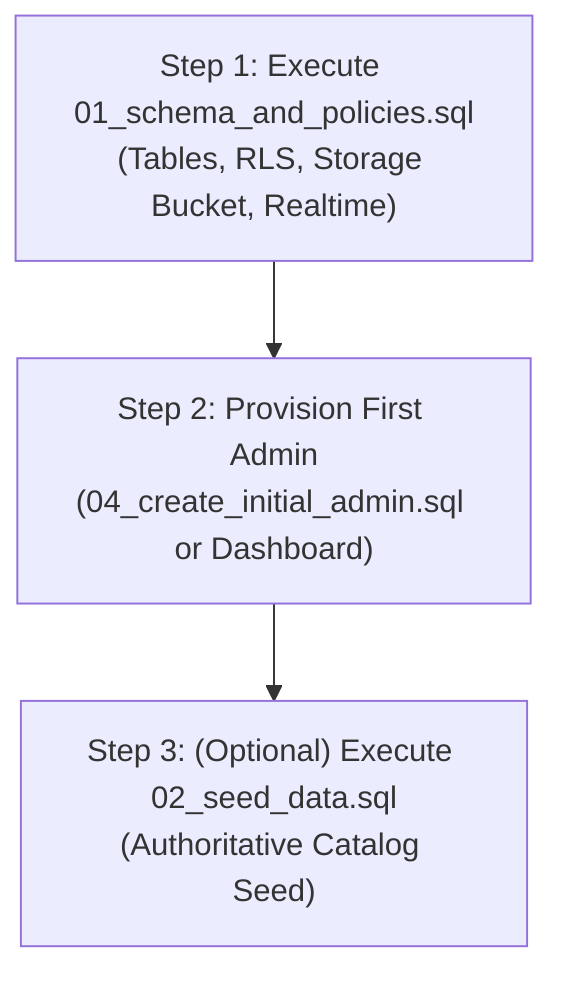

# RoyalRides Travels - Supabase Database & Security Guide

This directory contains the canonical database migrations, Row Level Security (RLS) policies, storage bucket configurations, and seed scripts for **RoyalRides Travels**.

---

## 1. SQL File Directory & Deduplication Map

To prevent confusion between manual execution in the Supabase Dashboard SQL Editor and Supabase CLI automation, the files are organized and synchronized as follows:

| File Name | Role | Supabase CLI Equivalent | Purpose |
| :--- | :--- | :--- | :--- |
| **`01_schema_and_policies.sql`** | **Primary Canonical Migration** | `schema.sql` | Creates all 9 tables, indexes, constraints, triggers, strict RLS policies, `travel-assets` storage bucket & policies, Realtime publication, and schema cache reload. |
| **`04_create_initial_admin.sql`** | **Admin Provisioning** | *Manual / Dashboard* | Safely creates or elevates the first administrative user without ever granting admin roles to standard signups. |
| **`02_seed_data.sql`** | **Optional Catalog Seed** | `seed.sql` | Seeds initial fleet cars, routes, verified pricing, destinations, reviews, and settings with `ON CONFLICT DO NOTHING`. |
| **`03_realtime_publications.sql`** | **Standalone Utility** | *Embedded in 01* | Standalone utility script to retrofit Realtime replica identity on pre-existing databases (already included in `01_schema_and_policies.sql`). |

---

## 2. Safe Execution Sequence (Step-by-Step)

Follow this order in the **Supabase Dashboard > SQL Editor**:



### Step 1: Run `supabase/01_schema_and_policies.sql`
- **Where**: Supabase Dashboard > SQL Editor > New query.
- **What it does**:
  1. Installs `uuid-ossp` extension.
  2. Creates tables: `profiles`, `cars`, `routes`, `route_prices`, `destinations`, `reviews`, `inquiries`, `site_settings`, `homepage_sections`.
  3. Sets up `handle_new_user()` trigger on `auth.users` that defaults every new user to `'customer'` (**never** admin).
  4. Configures `public.is_admin()` helper function.
  5. Implements strict Row Level Security (RLS):
     - **Public**: Can only view active cars, active routes, published destinations, published reviews, and submit inquiries (`status = 'New'`). Public cannot view inquiries.
     - **Customers**: Can only read and update their own profile (`id = auth.uid()`), cannot elevate their role.
     - **Administrators**: Full CRUD access across all tables.
  6. Creates and configures the `travel-assets` public storage bucket with strict admin upload/delete policies.
  7. Configures `supabase_realtime` publication for live synchronization.
  8. Sends `notify pgrst, 'reload schema'` to refresh PostgREST API cache.

### Step 2: Provision the First Administrator
Follow either method:
- **Method A (Supabase Dashboard - Recommended)**:
  1. Go to **Authentication > Users** in Supabase Dashboard.
  2. Click **Add user** > **Create user**.
  3. Enter email (e.g. `admin@royalrides.com`) and a strong password.
  4. Ensure **Auto Confirm User?** is checked.
  5. In SQL Editor, run Part 1 of `supabase/04_create_initial_admin.sql`:
     ```sql
     UPDATE public.profiles
     SET role = 'admin', full_name = 'RoyalRides Administrator'
     WHERE email = 'admin@royalrides.com';
     ```
- **Method B (Direct SQL in SQL Editor)**:
  1. Open `supabase/04_create_initial_admin.sql`.
  2. Set your desired email and strong password in the variables at the top of the `DO $$` block.
  3. Run the script.

### Step 3 (Optional): Run `supabase/02_seed_data.sql`
- Run this file if you need initial demo data.
- **Data safety**: Every `INSERT` statement specifies `ON CONFLICT (id) DO NOTHING`. Running this script will never overwrite modified live pricing, custom routes, or existing customer inquiries.

---

## 3. Resolving Reported Issues

### 404 Errors on `/rest/v1/cars`, `/routes`, `/inquiries`
- **Cause**: PostgREST returns HTTP 404 when tables do not exist in the database or the schema cache is stale.
- **Fix**: Executing `01_schema_and_policies.sql` creates all tables and notifies PostgREST (`notify pgrst, 'reload schema'`) to reload immediately.

### HTTP 400 on `/auth/v1/token?grant_type=password`
- **Cause**: Returned by Supabase GoTrue Auth when:
  1. The user account does not exist in `auth.users`.
  2. Incorrect password.
  3. "Confirm email" is enabled in Supabase Auth and the user's email was not confirmed.
- **Fix**: Use Step 2 above to create a confirmed admin account.

### Storage: "Bucket not found" on `travel-assets`
- **Cause**: Attempting to upload to `travel-assets` when the bucket hasn't been created in Supabase Storage.
- **Fix**: `01_schema_and_policies.sql` inserts `travel-assets` into `storage.buckets` with `public = true` and creates RLS policies allowing public viewing and administrator uploads/deletions.

---

## 4. Manual Dashboard Settings Checklist

Verify these settings in the Supabase Dashboard:

1. **Authentication > Providers > Email**:
   - If in staging/development and testing admin logins without an SMTP provider, turn **Confirm email** OFF or use "Auto Confirm User" when creating test accounts.
2. **Authentication > URL Configuration**:
   - Set **Site URL** to `http://localhost:3000` (or production URL).
   - Add `http://localhost:3000/**` to **Redirect URLs**.
3. **Storage > Buckets**:
   - Verify that `travel-assets` appears in the list and has the **Public** badge.
